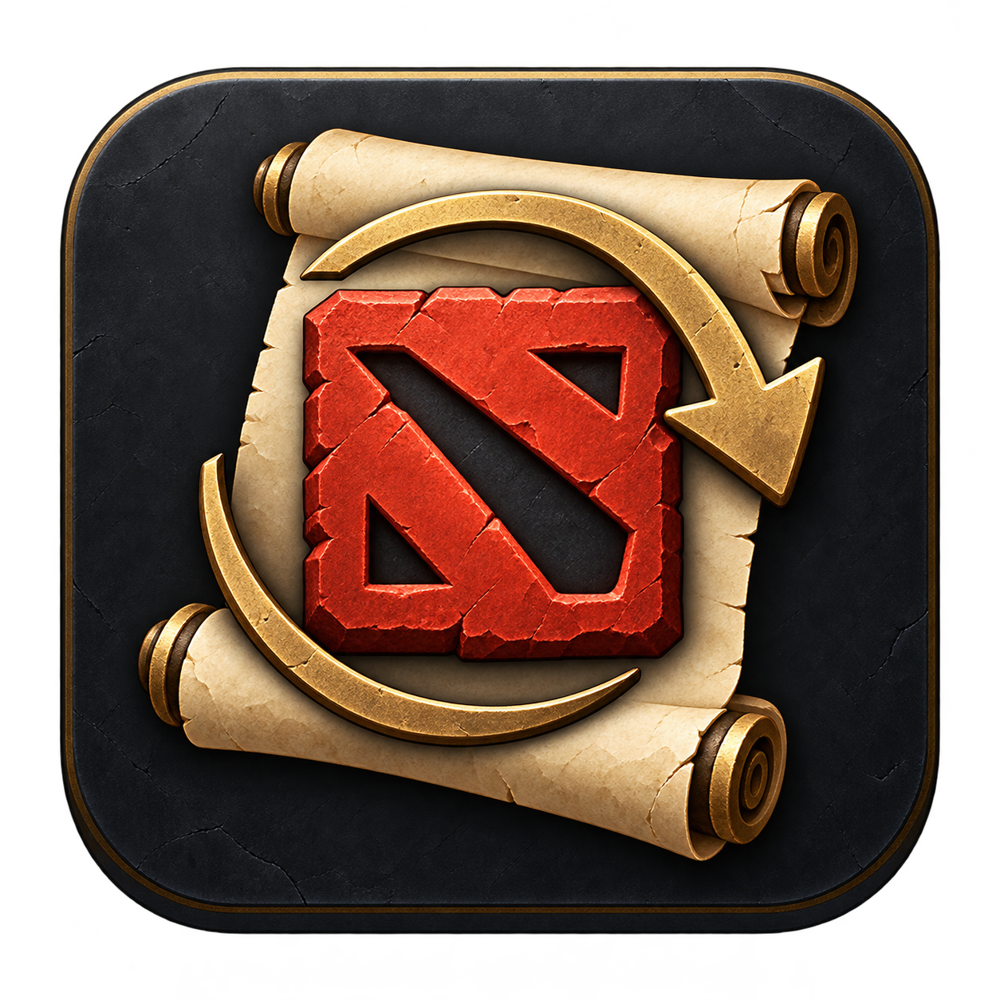

# 泉印 · Dota 2 配置管家

把熟悉的操作，留在自己手里。Windows 本地设置工具：保存键位、小地图、镜头与个人偏好，支持回滚和自己的 GitHub 私有备份。

下载源码 ZIP 并解压，双击 **泉印.exe**；也可使用 **Start.cmd**。本地功能使用 Windows 自带 PowerShell 5.1 / WPF，无需管理员权限。GitHub 功能另需 [GitHub CLI](https://cli.github.com/)。

## 三个递进级别

| 级别 | 功能 |
| --- | --- |
| 简单操作（默认） | 打开配置目录、保存、导出、拖入/路径导入、预览、替换及自动回滚 |
| 进阶 | 包含简单操作，增加自己的 GitHub 私有仓库上传和下载 |
| 高级功能 | 包含进阶，增加文件及内部参数查看、搜索、用途说明和可选的自定义保存范围 |

三个级别共用一个方案库。高级自选范围默认关闭，离开高级级别会恢复默认范围；查看参数不会执行或修改配置。

## 默认保存在程序内

- `data/profiles/`：个人快照。
- `data/exports/`：默认导出文件夹，包含原配置文件和 `backup.json`。
- `data/rollback/`：每次替换前的自动备份。

“保存并打开”保存新版本并打开导出目录。**不会默认保存到桌面**。需要传递时选择方案，点“导出所选到桌面”；也可指定 U 盘或其他位置。

## 导入与替换

可拖入泉印导出文件夹、快照 JSON、单个配置文件或普通配置目录。也可通过选择器或粘贴路径导入。普通目录有歧义时需选择原配置对应位置。

导入只进入方案库。先预览，再替换；替换前必须关闭该游戏的 Steam 云同步，并正常退出 Steam 和 Dota 2。工具自动备份、写入并校验，失败时尝试回滚。

导入完整导出目录时读取清单中的原文件，允许修改后再导入；直接导入 `backup.json` 则读取导出瞬间的快照。原本存在的文件缺失时会拒绝目录导入。普通文件/目录只导入实际存在的支持文件，不会清理其他设置。

## 为什么不只复制 cfg

玩家配置分散在账号的 `local/cfg`、`remote/cfg`、`remote` 根目录、`remote/scripts` 和游戏安装目录的 `game/dota/cfg`。默认方案会保存关键键位、操作选项、编组、网格、命石偏好，以及 autoexec / 小地图预设，默认不包含画质。

高级页可按文件查看参数名、原始值、分组路径、行号和用途。已知用途、结构说明、按名称归类、待确认、未解析原文分别标注；不会猜测未知含义或硬编码随版本改变的枚举值。

完整目录和文件说明见程序内的 **使用说明书** 或 [使用说明.txt](使用说明.txt)。

## GitHub

登录自己的 GitHub，填 `用户名/仓库名`，使用已有可写私有仓库或点击新建。上传所选版本，换电脑后下载到同一个方案库。凭据由 GitHub CLI 管理，程序不保存 token。

源码与个人备份分开，`.gitignore` 排除 `data/`。单快照上传上限 900 KB。快照可还原原始文件字节，但不是加密容器，请只恢复可信配置。

## 开发与验证

```powershell
# 构建带图标的 Windows 启动器
powershell -NoProfile -ExecutionPolicy Bypass -File .\Build.ps1
# 隔离测试，不覆盖真实游戏文件
powershell -NoProfile -ExecutionPolicy Bypass -File .\tests\Run.Tests.ps1
# 窗口渲染冒烟
powershell -NoProfile -ExecutionPolicy Bypass -STA -File .\DotaSettings.ps1 -SmokeTest -DataDirectory C:\Temp\FountainSmoke
```

支持原有 `List/Save/Preview/Apply/Upload/Download/CreateRepo` 命令行操作，并增加 `Export -Snapshot ... -Destination ...` 和 `Import -InputPath ...`。

验证范围见 [VALIDATION.md](VALIDATION.md)。文件校验不代表已验证游戏启动后的效果或 Steam 云冲突。项目使用原创生成图标，表达 Dota 2 设置工具的用途；项目不是 Valve 官方产品。
